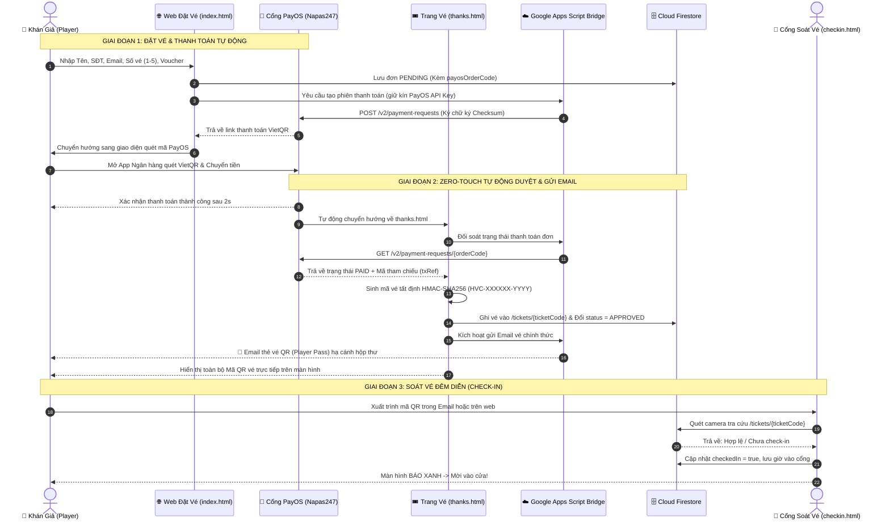

# 🕹️ HƯỚNG DẪN KIẾN TRÚC & LUỒNG HOẠT ĐỘNG HỆ THỐNG (GAME ON E-TICKET)

> **Tài liệu dành cho:** Thành viên Ban Tổ Chức (BTC), Lập trình viên tiếp nhận dự án, hoặc bất kỳ ai muốn nắm trọn quy trình vận hành của hệ thống bán vé **Hùng Vương Concert: GAME ON**.

---

## 📌 1. TỔNG QUAN HỆ THỐNG

Hệ thống được thiết kế theo kiến trúc **Serverless 100% (Không cần thuê máy chủ riêng, 0đ phí duy trì)**, tự động hóa từ A–Z:
- **Khách mua vé**: Quét mã VietQR động qua cổng thanh toán **PayOS (Napas247)**.
- **Xác thực thanh toán**: Nhận diện tiền vào tài khoản ngân hàng trong **2–3 giây**, **không cần khách chụp màn hình hay tải ảnh biên lai**.
- **Cấp vé & Gửi Email**: Tự động chuyển đơn sang `APPROVED`, tự động sinh mã vé bảo mật bằng thuật toán **HMAC-SHA256**, và tự động bắn **Email Vé Điện Tử (Player Pass QR)** về hộp thư Gmail của khách.
- **Soát vé tại cổng (Check-in)**: Tình nguyện viên mở camera quét mã QR trên điện thoại, hệ thống khóa vé ngay tức thì chống quay vòng vé (1 vé dùng cho nhiều người).

---

## 🔄 2. SƠ ĐỒ LUỒNG HOẠT ĐỘNG TỔNG THỂ (END-TO-END WORKFLOW)



---

## 🛠️ 3. CHI TIẾT 4 MẮT XÍCH TRONG HỆ THỐNG

### Mắt xích 1: Trang Đặt Vé (`index.html` & `js/checkout.js`)
* **Giao diện**: Mang tone màu chủ đạo **Đêm Đỏ Crimson & Vàng Sao Pixel (`Night Crimson & Star Gold`)** chuẩn concept **Hùng Vương Concert: GAME ON**.
* **Xử lý đơn hàng**:
  - Tự động tính tổng tiền theo đơn giá (320.000đ/vé), tự trừ chiết khấu nếu áp dụng Voucher (`GAMEON`, `HVCGAMEON`, `CHV`...).
  - Lưu nháp tự động (`localStorage`): Khách lỡ tay tắt trang thì thông tin đã nhập vẫn còn nguyên.
  - Sinh số định danh duy nhất `payosOrderCode` (9 chữ số) và tạo document trong collection `orders` trên Cloud Firestore.
  - Gọi Google Apps Script Bridge để lấy URL thanh toán VietQR động của PayOS và chuyển hướng khách sang thanh toán.

### Mắt xích 2: Tự Động Duyệt & Phát Hành Vé (`thanks.html` & `js/ticket-service.js`)
* **Không cần con người can thiệp (Zero-Touch)**:
  - Khi khách thanh toán xong từ App Ngân hàng, PayOS tự động chuyển hướng khách về trang `thanks.html?orderId=...&orderCode=...`.
  - Hàm `autoFulfillPayosOrder()` chạy ngay lập tức (kèm cơ chế Polling kiểm tra lặp lại mỗi 3 giây nếu giao dịch liên ngân hàng phản hồi trễ).
  - Ngay khi PayOS xác nhận `isPaid: true`:
    1. **Sinh mã vé bảo mật**: Sử dụng thuật toán `HMAC-SHA256` dựa trên `orderId`, số thứ tự vé, `payosOrderCode` và mã tham chiếu giao dịch `reference`. Định dạng chuẩn: `HVC-XXXXXX-YYYY` (Ví dụ: `HVC-8K4P9X-E3A1`).
    2. **Đồng bộ cơ sở dữ liệu**: Lưu từng vé vào collection `tickets/{ticketCode}` với trạng thái `VALID`, `checkedIn: false`; lưu danh sách vé vào `order_tickets/{orderId}`; cập nhật trạng thái đơn trong `orders/{orderId}` thành `APPROVED`.
    3. **Bắn Email tự động**: Gửi email HTML chuẩn responsive gồm thông tin đơn hàng, lưu ý an toàn và thẻ vé điện tử kèm ảnh QR check-in sắc nét.
    4. **Hiển thị thẻ vé tại chỗ**: Ngay trên trang `thanks.html`, danh sách mã QR xuất hiện để người mua có thể chụp màn hình hoặc lưu ảnh về máy ngay lập tức.

### Mắt xích 3: Cơ Chế Dự Phòng & Quản Trị BTC (`admin-orders.html` & `check-order.html`)
* **Nếu khách lỡ tắt trình duyệt trước khi về `thanks.html`?**
  - Khách chỉ cần vào trang tra cứu `check-order.html` nhập Mã Đơn Hàng $\rightarrow$ Hệ thống tự nhận diện đơn PayOS chưa duyệt $\rightarrow$ Tự động kiểm tra với PayOS và kích hoạt cấp vé + gửi email bù ngay tại chỗ!
  - Trên trang quản trị `admin-orders.html`: Hệ thống tích hợp sẵn **Chế độ Auto-Pilot ngầm** tự động quét định kỳ mỗi **20 giây**. Bất kỳ đơn nào đã chuyển khoản đều được tự động đổi sang `APPROVED` và bắn mail tự động.
* **Bảo mật phân quyền (Zero-Knowledge)**:
  - Tình nguyện viên duyệt đơn chỉ thấy mã vé đã che mờ (`HVC-8K****-****`), **tuyệt đối không thể thấy mã vé thật kể cả khi mở F12 (DevTools)**.
  - Chỉ duy nhất tài khoản được chỉ định làm **Super Admin** mới có quyền giải mã và xem mã vé gốc.

### Mắt xích 4: Cổng Soát Vé Đêm Diễn (`checkin.html`)
* **Thao tác 1 giây tại cổng**:
  - Tình nguyện viên đăng nhập tài khoản BTC đã được cấp quyền.
  - Hướng camera điện thoại vào mã QR trên vé của khán giả (hoặc gõ mã vé).
  - **Kết quả hiển thị**:
    - 🟩 **Màu Xanh (Hợp lệ)**: Vé chính thức, tự động đánh dấu `checkedIn: true`, lưu thời gian và email người soát vé $\rightarrow$ Mời khách vào hội trường.
    - 🟨 **Màu Vàng (Đã sử dụng)**: Vé này đã quét trước đó rồi (Hiện rõ giờ quét trước và người đã quét) $\rightarrow$ Chặn đứng hành vi gian lận chụp ảnh vé gửi cho người khác vào sau.
    - 🟥 **Màu Đỏ (Không tồn tại)**: Vé giả mạo hoặc chưa từng được cấp trên hệ thống.

---

## 🔒 4. CẤU TRÚC BẢO MẬT ĐA TẦNG

1. **Khóa Bí Mật PayOS được giấu 100% trong Google Apps Script**:
   - `PAYOS_CLIENT_ID`, `PAYOS_API_KEY`, `PAYOS_CHECKSUM_KEY` lưu hoàn toàn trên Google Cloud Apps Script. Người dùng xem mã nguồn Javascript ở trình duyệt không thể thấy key, ngăn chặn kẻ gian tự tạo link thanh toán sửa giá 1.000đ.
2. **Không gian mã vé mật mã học (70 nghìn tỷ tổ hợp)**:
   - 6 ký tự Base32 (loại bỏ `I, L, O, U` tránh nhầm lẫn) tạo ra hơn 1,07 tỷ khả năng.
   - 4 ký tự chữ ký số HMAC-SHA256 (65.536 khả năng).
   - Xác suất đoán mò trúng 1 vé là $\approx 0,0000000028\%$.
3. **Quy tắc bảo mật cấp máy chủ (`firestore.rules`)**:
   - Khóa chặt mọi hành vi can thiệp sửa giá, sửa số lượng vé trên Firestore.
   - Cấm hoàn toàn lệnh tải danh sách toàn bộ vé (`allow list: if isSuperAdmin()`), ngăn nhân sự nội bộ tuồn danh sách vé ra ngoài.
4. **Chống báo động giả GitHub Secret Scanning**:
   - Khóa Firebase Web công khai trong `js/config.js` được tách thành mảng `.join("")` ở runtime, đảm bảo an toàn tuyệt đối khi push lên kho lưu trữ GitHub công khai.

---

## 📁 5. SƠ ĐỒ FILE TRONG DỰ ÁN

```text
payment_template/
├── index.html                 # Trang đặt vé & giao diện PayOS concept GAME ON
├── thanks.html                # Trang biên nhận & tự động kích hoạt cấp vé 100%
├── check-order.html           # Trang tra cứu đơn hàng & kích hoạt cấp vé bù
├── checkin.html               # Ứng dụng quét camera soát vé tại cổng đêm diễn
├── admin-orders.html          # Bảng điều khiển quản trị, đối soát PayOS & xuất Excel
├── firestore.rules            # Quy tắc bảo mật dữ liệu Cloud Firestore cấp Server
├── google-apps-script-mailer.gs # Cầu nối bảo mật PayOS & hệ thống gửi Email Gmail
├── LUONG_HE_THONG.md          # Tài liệu giải thích toàn bộ luồng hệ thống (file này)
├── README.md                  # Hướng dẫn cài đặt nhanh cho lập trình viên
├── style/
│   ├── checkout.css           # Bộ CSS theme Night Crimson & Star Gold
│   └── game-on-banner.jpg     # Ảnh Poster Key Visual chính thức GAME ON
└── js/
    ├── config.js              # Cấu hình trung tâm: Tên sự kiện, giá vé, voucher, Firebase
    ├── firebase-core.js       # Khởi tạo Firebase SDK Web Modular
    ├── ticket-service.js      # Thuật toán mã vé HMAC, API PayOS & gửi email xoay vòng
    ├── checkout.js            # Xử lý logic đặt vé trang index.html
    └── check-order.js         # Xử lý tra cứu đơn hàng trang check-order.html
```

---

## ⚡ 6. QUY TRÌNH KHI TRIỂN KHAI SỰ KIỆN MỚI

Khi muốn áp dụng bộ mã nguồn này cho một sự kiện tiếp theo:
1. **Chỉnh sửa cấu hình**: Mở [`js/config.js`](./js/config.js) sửa tên sự kiện, giá vé, voucher và tài khoản ngân hàng.
2. **Deploy Google Apps Script**: Tạo một Web App trên [script.google.com](https://script.google.com), dán nội dung [`google-apps-script-mailer.gs`](./google-apps-script-mailer.gs), điền key PayOS và lấy link Webhook dán vào `appsScriptWebhookUrl`.
3. **Publish Rules**: Copy [`firestore.rules`](./firestore.rules) dán vào tab **Rules** trên Firebase Console và nhấn **Publish**.
4. **Mở bán**: Đưa thư mục lên GitHub Pages, Vercel hoặc Firebase Hosting là hệ thống tự động vận hành 24/7!

